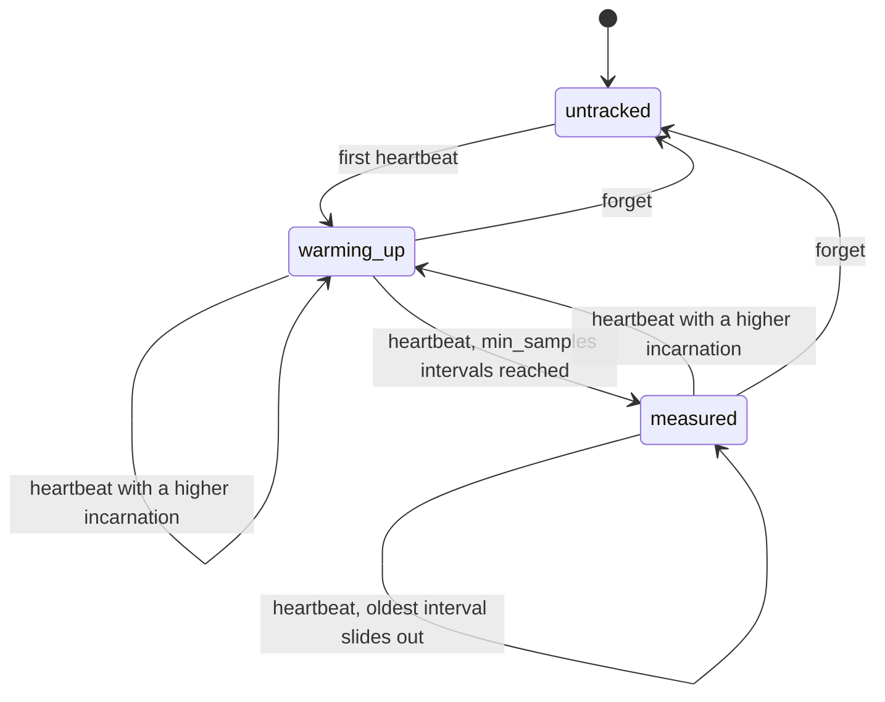
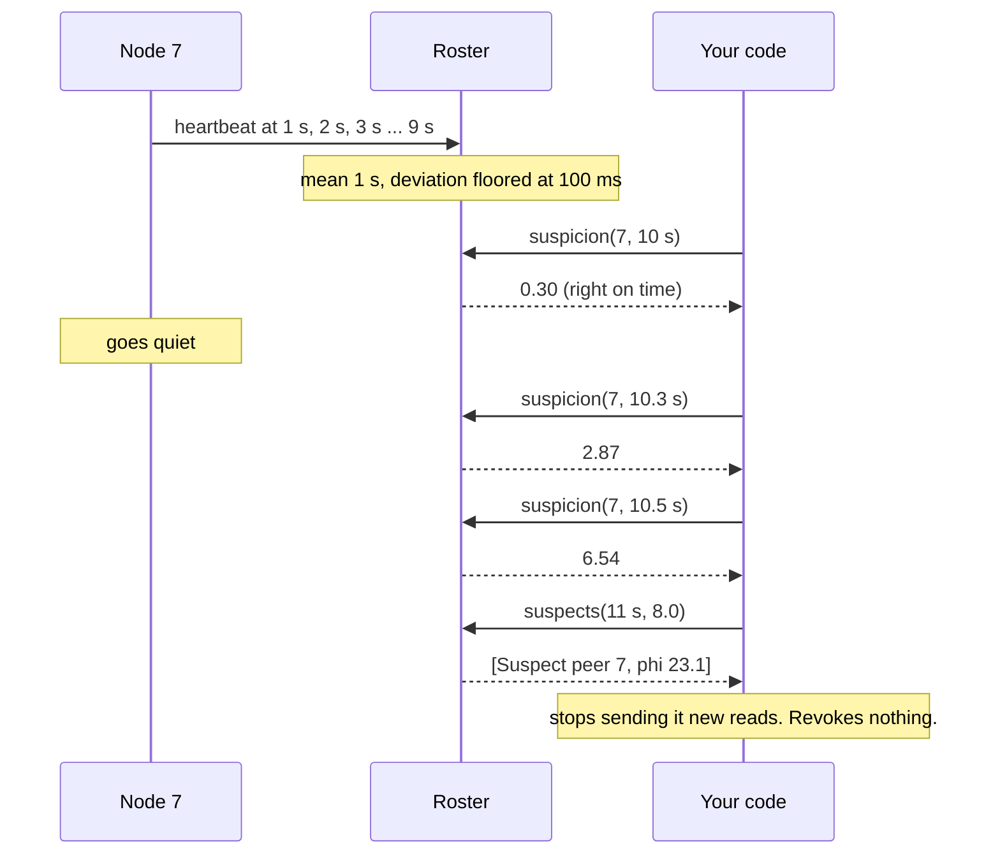

# SuspectMachines

> Silence is evidence. It is not a death certificate. 📡

A phi-accrual failure detector for Ruby. You tell the roster every time a peer's heartbeat arrives. Later you ask how suspicious that peer's silence is, and it answers with a number, phi, that grows the longer the peer stays quiet relative to how regular it used to be. What you do with the number is up to you. The roster never declares anyone dead.

## Quick Start

```bash
gem 'suspect_machines'
```

```ruby
roster = SuspectMachines::Roster.new(
  distribution: :normal,           # the shape you assume intervals have
  min_samples: 8,                  # intervals before any phi is reported
  min_std_dev_ns: 100_000_000      # 100 ms floor on the deviation
)

def on_heartbeat(roster, peer, incarnation, clock)
  roster.heartbeat(peer, incarnation, clock.now_ns)
end

def on_tick(roster, clock)
  roster.suspects(clock.now_ns, 8.0).suspects.each do |suspect|
    stop_routing_reads_to(suspect.peer)   # a hint, cheap to undo
  end
end
```

One roster, two verbs: `heartbeat` when you hear from a peer, `suspicion` or `suspects` when you want to know who has gone quiet. Peers, incarnations and times are Integers. Times are nanoseconds from a clock that only goes forward.

## A Message to the Resistance

So you wrote `dead = now - last_seen > 5.seconds`. It worked for a year. Then a node on a congested rack took 5.2 seconds between two heartbeats, your cluster declared it dead, rebalanced four hundred partitions onto its neighbours, and the neighbours, now twice as busy, started taking 5.2 seconds too.

So you raised the timeout to 30 seconds. Now a node that actually dies keeps receiving traffic for half a minute, and the node that heartbeats every 50 ms gets the same generosity as the one that heartbeats every 10 seconds.

A fixed timeout is one number pretending to describe every peer and every network on every day. The thing you wanted was: "this peer usually checks in every second, give or take 100 ms, and it has been quiet for 1.5 seconds. How unusual is that?" That question has an answer, and the answer is a probability, not a boolean. This gem computes it.

What it gives you is a suspicion level. It does not give you permission to take anything away from the suspect.

## Chapter 1: Stardate 2026.316, the AMS Hayashibara

> **AMS Hayashibara**, NCC-4223, *Hayashibara*-class picket vessel.
> The picket reports how long the lamp has been dark. The admiralty decides what that means.

A picket vessel sits at the edge of the formation and watches the signal lamps of the ships beyond it. It keeps a log of how regularly each lamp has flashed. When a lamp goes dark, the picket does not announce that the ship is lost. It reports that this ship, which flashed every sixty seconds for a month, has now been dark for four minutes, and that this is very unlike it.

On a bridge somewhere, a cadet volunteers:

```ruby
def lost?(ship)
  Time.now - ship.last_flash > 300
end

reassign_escort_duty(ship) if lost?(ship)
```

"That," says the picket's signals officer, "is a ship in fog being relieved of its command by a stopwatch."

## The Flight Plan

Each peer the roster knows about is in one of these states:



Only `measured` peers have a phi. And one quiet afternoon on node 7:



## How the Picket Works

### Heartbeat

```ruby
SECOND = 1_000_000_000
roster = SuspectMachines::Roster.new(distribution: :normal, min_samples: 3, min_std_dev_ns: 100_000_000)

roster.heartbeat(7, 1, 0)            # => :first      peer 7, incarnation 1, now 0 ns
roster.heartbeat(7, 1, 1 * SECOND)   # => :recorded
roster.heartbeat(7, 1, 2 * SECOND)   # => :recorded
roster.heartbeat(7, 1, 3 * SECOND)   # => :recorded
```

The first heartbeat is only a reference point. Each one after it records the interval since the previous one. The roster keeps the last 128 intervals per peer; the 129th pushes the oldest out.

### Warm-up

```ruby
roster = SuspectMachines::Roster.new(distribution: :normal, min_samples: 3, min_std_dev_ns: 100_000_000)
roster.heartbeat(7, 1, 0)
roster.heartbeat(7, 1, 1 * SECOND)

roster.suspicion(7, 60 * SECOND)     # => :warming_up
roster.last_heartbeat_ns(7)          # => 1000000000
```

Until a peer has `min_samples` intervals on record, the roster has no basis for a phi and says so. It does not guess. A peer that sends one heartbeat and vanishes stays `:warming_up` forever, so use `last_heartbeat_ns` with a plain timeout of your own for peers that never finish warming up.

### Suspicion

```ruby
# after heartbeats at 0, 1, 2 and 3 seconds
roster.suspicion(7, 4 * SECOND)                # => 0.30102999566398114
roster.suspicion(7, 4 * SECOND + 300_000_000)  # => 2.8696990359293695
roster.suspicion(7, 4 * SECOND + 500_000_000)  # => 6.542645672390655
roster.suspicion(9, 4 * SECOND)                # => :untracked
```

Phi is `-log10` of the probability that a heartbeat would still show up after this much silence. Phi 1 means about a 10% chance the peer is merely late. Phi 3 means about 0.1%. Phi 8 is a common place to start acting. Asking never changes anything, so ask as often as you like.

### Distributions

The probability depends on what you assume intervals look like. You must say which:

```ruby
SuspectMachines::Roster.new(distribution: :normal, min_samples: 8, min_std_dev_ns: 100_000_000)
SuspectMachines::Roster.new(distribution: :exponential, min_samples: 8)
```

`:normal` uses the mean and standard deviation of the window. A peer that beats like a metronome has a deviation of zero, which would make the first late nanosecond infinitely suspicious, so the deviation is never taken below `min_std_dev_ns`. `:exponential` uses only the mean: `phi = silence / (mean * ln 10)`. It climbs in a straight line and is more forgiving of bursty arrivals.

```ruby
roster = SuspectMachines::Roster.new(distribution: :exponential, min_samples: 1)
[0, 10, 20].each { |now| roster.heartbeat(1, 0, now) }
roster.suspicion(1, 50)   # => 1.3028834457097553, three mean intervals of silence
```

The roster does not check that your traffic matches the shape you picked.

### Acceptable pause

```ruby
roster = SuspectMachines::Roster.new(distribution: :exponential, min_samples: 1, acceptable_pause_ns: 5)
[0, 10, 20].each { |now| roster.heartbeat(1, 0, now) }
roster.suspicion(1, 24)   # => 0.0
roster.suspicion(1, 55)   # => 1.3028834457097553
```

If your peers are known to stall for a garbage collection or a fsync, give them that much silence for free. Suspicion starts accruing after the pause.

### Suspects

```ruby
scan = roster.suspects(now_ns, 8.0)
scan.suspects      # => [#<data SuspectMachines::Suspect peer=7, incarnation=1, phi=23.118053405486076>]
scan.next_cursor   # => nil
```

`suspects` lists every measured peer whose phi has reached the threshold. It returns at most `limit` of them, and a cursor when there are more:

```ruby
page = roster.suspects(now_ns, 8.0, limit: 16)
while page.next_cursor
  page = roster.suspects(now_ns, 8.0, cursor: page.next_cursor, limit: 16)
end
```

Peers still warming up are never listed.

### Statistics

```ruby
stats = roster.statistics(7)
stats.samples      # => 3
stats.mean_ns      # => 1000000000.0
stats.std_dev_ns   # => 0.0
stats.min_ns       # => 1000000000
stats.max_ns       # => 1000000000
```

What the roster currently believes about a peer's rhythm, over the intervals in its window. `nil` before the second heartbeat. The deviation shown is the measured one, before the floor.

### Incarnations

```ruby
roster = SuspectMachines::Roster.new(distribution: :exponential, min_samples: 1)
roster.heartbeat(1, 5, 100)   # => :first
roster.heartbeat(1, 5, 200)   # => :recorded
roster.heartbeat(1, 4, 300)   # => :stale       an older incarnation, ignored
roster.heartbeat(1, 6, 300)   # => :restarted   statistics start over
roster.incarnation(1)         # => 6
roster.suspicion(1, 400)      # => :warming_up
```

When a peer restarts, have it announce a higher incarnation. A delayed heartbeat from the old process can't refresh the new one, and the new process doesn't inherit the old one's rhythm.

### Forget

```ruby
roster.forget(1)   # => true
roster.forget(1)   # => false
```

The roster never drops a peer on its own, however suspicious. Membership is yours. When you decide a peer is gone, forget it and its slot is free.

### Capacity

```ruby
roster = SuspectMachines::Roster.new(distribution: :exponential, min_samples: 1)
SuspectMachines::Roster::CAPACITY                  # => 64
SuspectMachines::Roster::WINDOW                    # => 128
64.times { |peer| roster.heartbeat(peer, 0, 0) }
roster.heartbeat(64, 0, 0)                         # => :full
roster.forget(3)                                   # => true
roster.heartbeat(64, 0, 0)                         # => :first
```

Sixty-four peers, 128 intervals each, compiled in. A full roster refuses new peers. It does not evict a tracked one to make room.

### Time only moves forward

```ruby
roster = SuspectMachines::Roster.new(distribution: :exponential, min_samples: 1)
roster.heartbeat(1, 0, 100)   # => :first
roster.heartbeat(1, 0, 99)    # => :time_regression
roster.heartbeat(1, 0, 100)   # => :duplicate
roster.suspicion(1, 99)       # => :time_regression
```

Each peer's heartbeats must arrive in increasing time. Two at the same instant carry no interval, so the second is refused. Feed it a monotonic clock in nanoseconds, read where the heartbeat is received.

## The Rules of the Picket

- **Phi is advisory.** It is a statement about arrival statistics. It cannot revoke a lease, depose a leader, or release a lock. Anything that changes ownership needs a durable authority and fencing at the resource.
- **Assumptions are arguments.** `distribution:` and `min_samples:` have no defaults. `:normal` requires `min_std_dev_ns:`. `:exponential` rejects it.
- **Peers, incarnations and times are Integers** in `0..2**64-1`. Times are nanoseconds. Floats, nil, and strings raise `TypeError`. Out of range raises `RangeError`. A threshold is a finite Float or Integer above zero.
- **Refusals don't raise.** `:time_regression`, `:duplicate`, `:stale`, `:full`, `:untracked` and `:warming_up` are answers. A refused heartbeat changes nothing. Only malformed input raises.
- **Same calls, same floats.** The square root, exponential, logarithm and normal tail are computed in the gem from plain IEEE arithmetic, with no platform math library. Phi is within `1e-12` (absolute or relative) of the exact value for the statistics it was given.
- **Frozen means frozen.** `freeze` the roster and `heartbeat` and `forget` raise `FrozenError`. Reads still work.

## What You Think You're Doing vs Reality

### You Think: "Phi crossed 8, so the node is dead and I can take over its work."
### Reality: Phi crossed 8, so the node is quiet from where you're standing.

A node in a long GC pause is quiet. A node behind a partitioned switch is quiet to you and chatty to everyone else. Both will come back and carry on writing as if nothing happened. If your takeover depends on the old owner having stopped, phi can't promise that. A lease with a fencing token checked by the storage can. Use phi to decide when to *ask* for a new owner, and let the authority decide whether there is one.

### You Think: "A higher threshold means fewer mistakes."
### Reality: A higher threshold means different mistakes.

Under `:normal` with a tight deviation, phi goes from 3 to 23 in a few hundred milliseconds. Moving the threshold from 8 to 12 buys almost nothing. What governs false suspicion is whether the window has seen the peer's bad days: a window of 128 calm intervals knows nothing about the weekly backup that stalls heartbeats for four seconds. Set `min_std_dev_ns` and `acceptable_pause_ns` from the stalls you know about.

## What's Yours

This is an initial, unstable API around a policy core. It is not a membership service. You own the clock, the transport that carries heartbeats, and the timer that calls `suspects`. You own what a suspicion triggers, and making that reversible. You own membership: adding peers by their first heartbeat, bumping incarnations on restart, and calling `forget`. The roster lives in your process and forgets everything when the process does, so every restart begins with a fresh warm-up. One long outage that ends in a heartbeat enters the window as one very long interval and loosens the peer's statistics until it slides out. If that matters, `forget` the peer on recovery and let it warm up again.

## License

MIT License. See [LICENSE.txt](LICENSE.txt) for details.

**Remember: the lamp went dark. That is all you know.**
