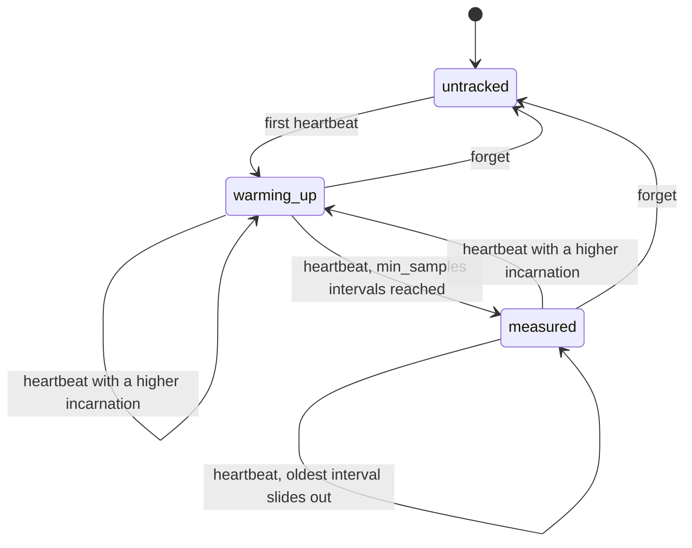

# SuspectMachines

> Silence is evidence. It is not a death certificate. 📡

A phi-accrual failure detector for Ruby. You tell the roster every time a peer's heartbeat arrives. Later you ask how suspicious that peer's silence is, and it answers with a number, phi, that grows the longer the peer stays quiet relative to how regular it used to be. What you do with the number is up to you. The roster never declares anyone dead.

## Quick Start

```bash
gem 'suspect_machines'
```

```ruby
SM = SuspectMachines

normal = SM::Normal.new(100_000_000)   # the shape you assume intervals have, with a 100 ms floor on the deviation
roster = SM::Roster.new(SM::Config.new(normal, 8))   # 8 intervals before any phi is reported
act_at = SM::Threshold.new(8.0)

def now = Process.clock_gettime(Process::CLOCK_MONOTONIC, :nanosecond)

def on_heartbeat(roster, peer, incarnation)
  roster.heartbeat(peer, incarnation, now)
end

def on_tick(roster)
  roster.scan(now, act_at, 0, SM::Roster::CAPACITY).suspects.each do |suspect|
    stop_routing_reads_to(suspect.peer)   # a hint, cheap to undo
  end
end
```

One roster, two verbs: `heartbeat` when you hear from a peer, `suspicion` or `scan` when you want to know who has gone quiet. `SM` is only an alias to keep the lines short. A `Config` is the core's: the distribution you assume and the warm-up, in that order. Peers, incarnations and times are Integers. Times are nanoseconds from a clock that only goes forward.

## A Message to the Resistance

So you wrote `dead = now - last_seen > 5.seconds`. It worked for a year. Then a node on a congested rack took 5.2 seconds between two heartbeats, your cluster declared it dead, rebalanced four hundred partitions onto its neighbours, and the neighbours, now twice as busy, started taking 5.2 seconds too.

So you raised the timeout to 30 seconds. Now a node that actually dies keeps receiving traffic for half a minute, and the node that heartbeats every 50 ms gets the same generosity as the one that heartbeats every 10 seconds.

A fixed timeout is one number pretending to describe every peer and every network on every day. The thing you wanted was: "this peer usually checks in every second, give or take 100 ms, and it has been quiet for 1.5 seconds. How unusual is that?" That question has an answer, and the answer is a probability, not a boolean. This gem computes it.

What it gives you is a suspicion level. It does not give you permission to take anything away from the suspect.

## Chapter 1: Stardate 2026.316, the AMS Hayashibara

> **AMS Hayashibara**, NCC-4223, *Hayashibara*-class picket vessel.
> The picket reports how long the lamp has been dark. The admiralty decides what that means.

A picket vessel sits at the edge of the formation and watches the signal lamps of the ships beyond it. It keeps a log of how regularly each lamp has flashed. When a lamp goes dark, the picket does not announce that the ship is lost. It reports that this ship, which flashed every sixty seconds for a month, has now been dark for four minutes, and that this is very unlike it.

On a bridge somewhere, a cadet volunteers:

```ruby
def lost?(ship)
  Time.now - ship.last_flash > 300
end

reassign_escort_duty(ship) if lost?(ship)
```

"That," says the picket's signals officer, "is a ship in fog being relieved of its command by a stopwatch."

## The Flight Plan

Each peer the roster knows about is in one of these states:



Only `measured` peers have a phi. And one quiet afternoon on node 7:


## How the Picket Works

### Heartbeat

```ruby
SECOND = 1_000_000_000
roster = SM::Roster.new(SM::Config.new(SM::Normal.new(100_000_000), 3))

roster.heartbeat(7, 1, 0)            # => :first      peer 7, incarnation 1, now 0 ns
roster.heartbeat(7, 1, 1 * SECOND)   # => #<data SuspectMachines::Recorded interval=1000000000, samples=1>
roster.heartbeat(7, 1, 2 * SECOND)   # => #<data SuspectMachines::Recorded interval=1000000000, samples=2>
roster.heartbeat(7, 1, 3 * SECOND)   # => #<data SuspectMachines::Recorded interval=1000000000, samples=3>
```

The first heartbeat is only a reference point. Each one after it records the interval since the previous one and answers a `Recorded`: that `interval`, and the `samples` now in the window. The roster keeps the last 128 intervals per peer; the 129th pushes the oldest out.

### Warm-up

```ruby
roster = SM::Roster.new(SM::Config.new(SM::Normal.new(100_000_000), 3))
roster.heartbeat(7, 1, 0)
roster.heartbeat(7, 1, 1 * SECOND)

roster.suspicion(7, 60 * SECOND)
# => #<data SuspectMachines::WarmingUp samples=1, required=3, silence=59000000000>
roster.last_heartbeat(7)             # => 1000000000
```

Until a peer has `min_samples` intervals on record, the roster has no basis for a phi and says so with a `WarmingUp`: the `samples` it has, the number `required`, and the `silence` since the last heartbeat. It does not guess. A peer that sends one heartbeat and vanishes stays warming up forever, so put a plain timeout of your own on that `silence` (or on `last_heartbeat`) for peers that never finish warming up.

### Suspicion

```ruby
# after heartbeats at 0, 1, 2 and 3 seconds
roster.suspicion(7, 4 * SECOND)
# => #<data SuspectMachines::Measured phi=#<data SuspectMachines::Phi value=0.30102999566398114>>
roster.suspicion(7, 4 * SECOND + 300_000_000).phi.value   # => 2.8696990359293695
roster.suspicion(7, 4 * SECOND + 500_000_000).phi.millis  # => 6542
roster.suspicion(9, 4 * SECOND)                           # => :untracked

case roster.suspicion(7, now)
in SM::Measured[phi:] then phi.reaches?(act_at)
in SM::WarmingUp[silence:] then silence > bootstrap_timeout
in Symbol => refusal then false   # :untracked, :time_regression
end
```

`suspicion` answers the core's `Suspicion`: a `Measured` carrying a `Phi`, or a `WarmingUp` while there is none yet. A `Phi` is the core's: its `value` is a finite, non-negative Float, `millis` is the level in thousandths rounded down (the core's `Phi::millis`), and `reaches?(threshold)` is the core's `Phi::reaches`. A `Threshold` is the core's too: a finite Float above zero, and the only thing `reaches?` and `scan` take as a threshold.

Phi is `-log10` of the probability that a heartbeat would still show up after this much silence. Phi 1 means about a 10% chance the peer is merely late. Phi 3 means about 0.1%. Phi 8 is a common place to start acting. Asking never changes anything, so ask as often as you like.

### Distributions

The probability depends on what you assume intervals look like. You must say which:

```ruby
SM::Config.new(SM::Normal.new(100_000_000), 8)   # Distribution::Normal(Normal::new(min_std_dev))
SM::Config.new(:exponential, 8)                  # Distribution::Exponential
```

A `Normal` uses the mean and standard deviation of the window. A peer that beats like a metronome has a deviation of zero, which would make the first late nanosecond infinitely suspicious, so the deviation is never taken below `min_std_dev`; a zero floor is a `RangeError` from `Normal.new`, as `Normal::new` refuses it in the core. `:exponential` uses only the mean: `phi = silence / (mean * ln 10)`. It climbs in a straight line and is more forgiving of bursty arrivals.

```ruby
roster = SM::Roster.new(SM::Config.new(:exponential, 1))
[0, 10, 20].each { |now| roster.heartbeat(1, 0, now) }
roster.suspicion(1, 50).phi.value   # => 1.3028834457097553, three mean intervals of silence
```

The roster does not check that your traffic matches the shape you picked.

### Acceptable pause

```ruby
config = SM::Config.new(:exponential, 1).with_acceptable_pause(5)
config.acceptable_pause       # => 5
roster = SM::Roster.new(config)
[0, 10, 20].each { |now| roster.heartbeat(1, 0, now) }
roster.suspicion(1, 24).phi.value   # => 0.0
roster.suspicion(1, 55).phi.value   # => 1.3028834457097553
roster.config == config       # => true
```

If your peers are known to stall for a garbage collection or a fsync, give them that much silence for free. Suspicion starts accruing after the pause. `Config.new` takes the two arguments of the core's `Config::new` and tolerates no pause; `with_acceptable_pause` answers a copy that does, as the core's builder does.

### Scan

```ruby
scan = roster.scan(now, SM::Threshold.new(8.0), 0, 64)   # now, threshold, cursor, limit
scan.suspects.first.phi.value   # => 23.118053405486076, for peer 7, incarnation 1
scan.next          # => nil
```

`scan` lists every measured peer whose phi has reached the threshold, as a `Scan`. All four arguments are required, as they are in the core: the instant, the threshold, the cursor to start from (zero the first time) and the `limit`, which stands for the length of the buffer the core writes into and is at most `Roster::CAPACITY`. It returns at most `limit` suspects, and `next` is the cursor to resume from when there are more. A peer whose last heartbeat is later than `now` has no silence to measure at that instant and is skipped, not refused (`suspicion` for that peer answers `:time_regression`):

```ruby
page = roster.scan(now, act_at, 0, 16)
while page.next
  page = roster.scan(now, act_at, page.next, 16)
end
```

Peers still warming up are never listed.

### Statistics

```ruby
stats = roster.statistics(7)
stats.samples      # => 3
stats.mean_ns      # => 1000000000.0
stats.std_dev_ns   # => 0.0
stats.min          # => 1000000000
stats.max          # => 1000000000
```

What the roster currently believes about a peer's rhythm, over the intervals in its window. `nil` before the second heartbeat. The deviation shown is the measured one, before the floor.

### Incarnations

```ruby
roster = SM::Roster.new(SM::Config.new(:exponential, 1))
roster.heartbeat(1, 5, 100)   # => :first
roster.heartbeat(1, 5, 200)   # => #<data SuspectMachines::Recorded interval=100, samples=1>
roster.heartbeat(1, 4, 300)   # => :stale       an older incarnation, ignored
roster.heartbeat(1, 6, 300)   # => :restarted   statistics start over
roster.incarnation(1)         # => 6
roster.suspicion(1, 400)      # => #<data SuspectMachines::WarmingUp samples=0, required=1, silence=100>
```

When a peer restarts, have it announce a higher incarnation. A delayed heartbeat from the old process can't refresh the new one, and the new process doesn't inherit the old one's rhythm.

### Forget

```ruby
roster.forget(1)   # => :forgotten
roster.forget(1)   # => :not_tracked
```

The roster never drops a peer on its own, however suspicious. Membership is yours. When you decide a peer is gone, forget it and its slot is free. Both answers are honoured: forgetting a peer that is not tracked is a repeat that changes nothing, not a refusal.

### Capacity

```ruby
roster = SM::Roster.new(SM::Config.new(:exponential, 1))
SuspectMachines::Roster::CAPACITY                  # => 64
SuspectMachines::Roster::WINDOW                    # => 128
64.times { |peer| roster.heartbeat(peer, 0, 0) }
roster.heartbeat(64, 0, 0)                         # => :full
roster.forget(3)                                   # => :forgotten
roster.heartbeat(64, 0, 0)                         # => :first
```

Sixty-four peers, 128 intervals each, compiled in. A full roster refuses new peers. It does not evict a tracked one to make room.

### Time only moves forward

```ruby
roster = SM::Roster.new(SM::Config.new(:exponential, 1))
roster.heartbeat(1, 0, 100)   # => :first
roster.heartbeat(1, 0, 99)    # => :time_regression
roster.heartbeat(1, 0, 100)   # => :same_instant
roster.suspicion(1, 99)       # => :time_regression
```

Each peer's heartbeats must arrive in increasing time. Two at the same instant carry no interval, so the second is refused. Feed it a monotonic clock in nanoseconds, read where the heartbeat is received.

### One peer on its own

```ruby
detector = SM::Detector.new(SM::Config.new(SM::Normal.new(100_000_000), 3))
detector.suspicion(0)             # => :no_heartbeat
detector.heartbeat(0)             # => :first
detector.heartbeat(1 * SECOND)    # => #<data SuspectMachines::Recorded interval=1000000000, samples=1>
detector.suspicion(2 * SECOND)    # => #<data SuspectMachines::WarmingUp samples=1, required=3, silence=1000000000>
detector.samples                  # => 1
detector.last_heartbeat           # => 1000000000
detector.statistics               # => a Statistics, nil before the second heartbeat
detector.config                   # => the Config
detector.reset                    # => nil, every interval and the last heartbeat are gone
```

A `Detector` is the core's single-peer type: the same window (`Detector::WINDOW`, 128 intervals) and the same answers, without peers, incarnations or capacity. It is the one place `suspicion` answers `:no_heartbeat`.

### What each call answers

| Call | Honoured | Records `now` | Refused, nothing changed |
| --- | --- | --- | --- |
| `Roster#heartbeat(peer, incarnation, now)` | `:first`, a `Recorded`, `:restarted` | every honoured answer: `now` becomes the peer's last heartbeat | `:time_regression`, `:same_instant`, `:stale`, `:full` |
| `Roster#suspicion(peer, now)` | a `Measured`, or a `WarmingUp` | never: a query | `:untracked`, `:time_regression` |
| `Roster#scan(now, threshold, cursor, limit)` | a `Scan` | never: a query | none reachable |
| `Roster#statistics(peer)` | a `Statistics`, or `nil` before the second heartbeat | no clock | a query, never refuses |
| `Roster#incarnation(peer)`, `Roster#last_heartbeat(peer)` | an Integer, or `nil` for an untracked peer | no clock | a query, never refuses |
| `Roster#forget(peer)` | `:forgotten`, or the repeat `:not_tracked` | no clock | never refuses |
| `Roster#size`, `Roster#empty?`, `Roster#config` | an Integer, a boolean, the `Config` | no clock | a query, never refuses |
| `Detector#heartbeat(now)` | `:first`, a `Recorded` | every honoured answer: `now` becomes the last heartbeat | `:time_regression`, `:same_instant` |
| `Detector#suspicion(now)` | `:no_heartbeat`, a `WarmingUp`, a `Measured` | never: a query | `:time_regression` |
| `Detector#reset` | `nil` | no clock; the last heartbeat is forgotten | never refuses |

A heartbeat is the observation of `now` itself, so every honoured heartbeat answer depends on `now` and records it; there is no honoured repeat of a heartbeat (the same instant again is `:same_instant`). `suspicion` and `scan` depend on `now` but are queries: they never change the roster or detector, so a later call may ask about an earlier instant, down to the last heartbeat.

The six refusal symbols are the six variants of the core's `Refusal`, each with its own symbol; there is no catch-all. One of them, `:overflow`, cannot be reached from Ruby: it is the core's answer to a time past `2**64-1` nanoseconds, and such an Integer raises `RangeError` before the core sees it. It is what `heartbeat`, `suspicion` and `scan` would answer. A roster's `suspicion` never answers `:no_heartbeat`, because a tracked peer always has a heartbeat.

`Phi`, `Threshold`, `Normal`, `Config`, `Recorded`, `WarmingUp`, `Measured`, `Statistics`, `Suspect` and `Scan` are frozen `Data` values with the fields of the core types they are named after. Each is checked by the core when it is built, whether the gem built it or you did (and by `with`): a wrong type raises `TypeError`, a value the core would never hold raises `RangeError`. So `Phi.new(-1)`, `Threshold.new(0)`, `Recorded.new(0, 1)` (a zero interval), `WarmingUp.new(3, 3, 0)` (the warm-up is over), `Statistics.new(1, 1.0, 0.0, 2, 1)` (min above max), `Statistics.new(2, 5.0, 0.0, 10, 20)` (a mean below the shortest interval), `Normal.new(0)` (no floor) and `Scan.new([], 64)` (no such slot) all raise `RangeError`; `Measured.new(1.0)` and `Suspect.new(1, 0, 4.0)` raise `TypeError`, because a phi is a `Phi`. The limits are the core's constructors for the compiled window and capacity: `Normal::new`, `Beat::recorded`, `Suspicion::warming_up`, `Statistics::new` and `Scan::new`. The classes are final: subclassing one raises `TypeError` and `allocate` is gone, so no instance skips the check. Sealing stops accidents, not reflection (a named subclass's constant is bound before `inherited` raises, and `Marshal.load` skips `initialize`), so the binding trusts no value it reads: each must be an instance of exactly the gem's class (a subclass raises `TypeError`) and is rebuilt through the core's constructor (a forged field raises `RangeError`). The classes are resolved once, at load. Building an answer runs Ruby code (`new`), so `heartbeat` (on a `Detector` and a `Roster`) decides on a copy, builds the answer, and keeps the copy only if the object is still unfrozen and unchanged: if building raises, the heartbeat is not recorded; if it freezes the object, `FrozenError`; if it re-enters and changes the object, `RuntimeError`, and the outer call is not applied. An enum's unit variant is a symbol and a variant that carries something is a `Data` named after it: a distribution is `:exponential` or a `Normal`, a beat is `:first`, a `Recorded` or `:restarted`, a suspicion is `:no_heartbeat`, a `WarmingUp` or a `Measured`. A phi and a threshold are the core's `Phi` and `Threshold`, as `Data` values carrying a Float `value`. A `Scan`'s `suspects` are the suspects themselves, where the core's `Scan::suspects` counts how many it wrote to the caller's buffer. `Roster#size` is the core's `len`.

## The Rules of the Picket

- **Phi is advisory.** It is a statement about arrival statistics. It cannot revoke a lease, depose a leader, or release a lock. Anything that changes ownership needs a durable authority and fencing at the resource.
- **Assumptions are arguments.** A `Config` takes its distribution and `min_samples` positionally and neither has a default. A `Normal` requires its `min_std_dev`. The acceptable pause is zero until `with_acceptable_pause` says otherwise, as in the core. `scan` has no default cursor or limit.
- **Peers, incarnations and times are Integers** in `0..2**64-1`. Times are nanoseconds. Floats, nil, and strings raise `TypeError`, and so does anything but a `Config` where one belongs. Out of range raises `RangeError`, and so do a zero `min_samples`, a zero deviation floor, a `min_samples` above the window and a `limit` above the capacity. So does an unknown distribution symbol. A threshold is a `Threshold`; anything else where one belongs raises `TypeError`.
- **Refusals don't raise.** `:time_regression`, `:same_instant`, `:stale`, `:full` and `:untracked` are answers. A refused heartbeat changes nothing. Only malformed input raises.
- **Same calls, same floats.** The square root, exponential, logarithm and normal tail are computed in the gem from plain IEEE arithmetic, with no platform math library. Phi is within `1e-12` (absolute or relative) of the exact value for the statistics it was given.
- **Frozen means frozen.** `freeze` a roster and `heartbeat` and `forget` raise `FrozenError`; `freeze` a detector and `heartbeat` and `reset` do. Reads still work.

## What You Think You're Doing vs Reality

### You Think: "Phi crossed 8, so the node is dead and I can take over its work."
### Reality: Phi crossed 8, so the node is quiet from where you're standing.

A node in a long GC pause is quiet. A node behind a partitioned switch is quiet to you and chatty to everyone else. Both will come back and carry on writing as if nothing happened. If your takeover depends on the old owner having stopped, phi can't promise that. A lease with a fencing token checked by the storage can. Use phi to decide when to *ask* for a new owner, and let the authority decide whether there is one.

### You Think: "A higher threshold means fewer mistakes."
### Reality: A higher threshold means different mistakes.

Under `:normal` with a tight deviation, phi goes from 3 to 23 in a few hundred milliseconds. Moving the threshold from 8 to 12 buys almost nothing. What governs false suspicion is whether the window has seen the peer's bad days: a window of 128 calm intervals knows nothing about the weekly backup that stalls heartbeats for four seconds. Set `min_std_dev` and `acceptable_pause` from the stalls you know about.

## What's Yours

This is an initial, unstable API around a policy core. It is not a membership service. You own the clock, the transport that carries heartbeats, and the timer that calls `scan`. You own what a suspicion triggers, and making that reversible. You own membership: adding peers by their first heartbeat, bumping incarnations on restart, and calling `forget`. The roster lives in your process and forgets everything when the process does, so every restart begins with a fresh warm-up. One long outage that ends in a heartbeat enters the window as one very long interval and loosens the peer's statistics until it slides out. If that matters, `forget` the peer on recovery and let it warm up again.

## License

MIT License. See [LICENSE.txt](LICENSE.txt) for details.

**Remember: the lamp went dark. That is all you know.**
